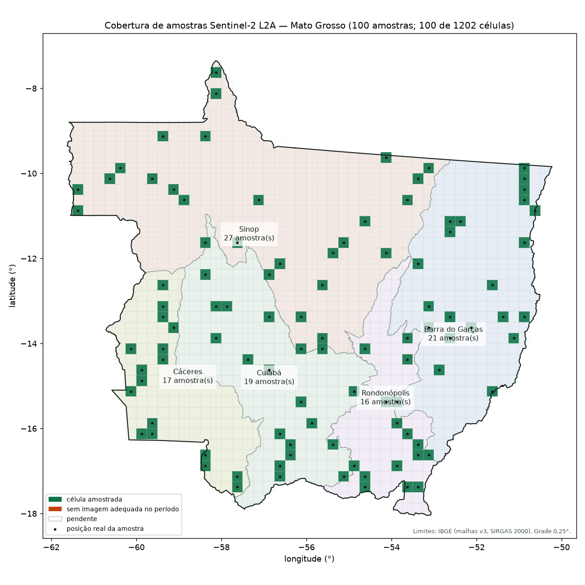
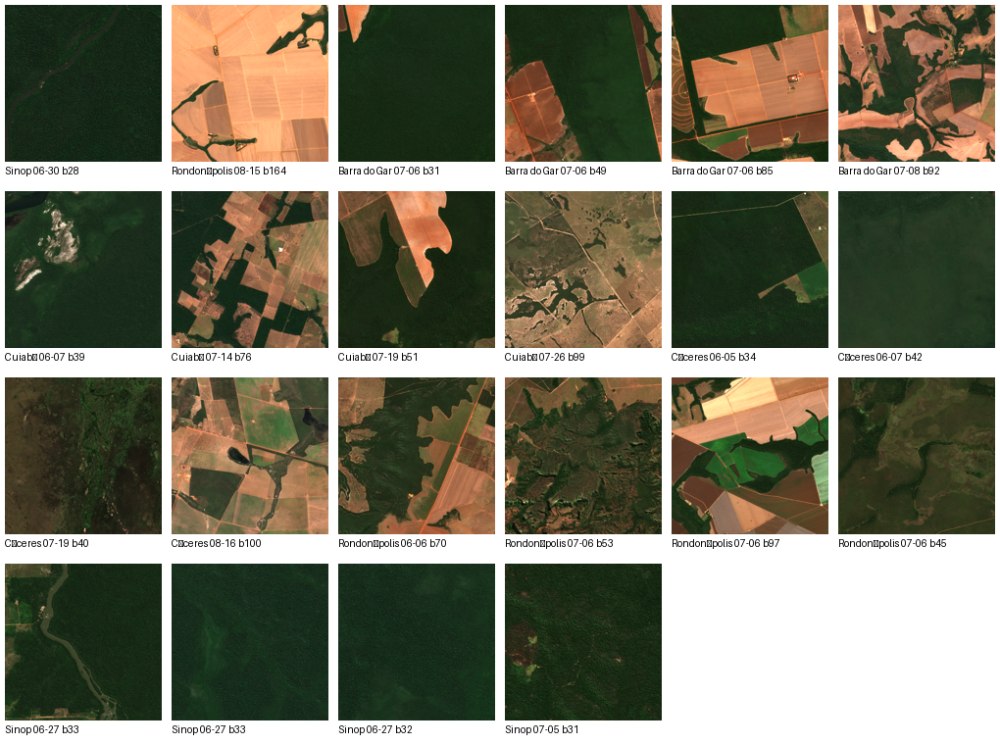
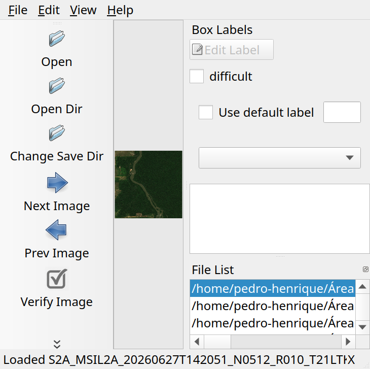

# Cobertura estadual de Mato Grosso — piloto 001

Data: 17/11/2026 · Branch: `feat/cobertura-mato-grosso` (worktree separado, **sem commit**) ·
Dados em `data/amostras-mt/` (não versionado).

**Resultado:** 100 imagens reais aprovadas de 100 células avaliadas, nas 5 regiões geográficas
intermediárias do IBGE. Todas legíveis, com metadados geográficos preservados, catálogo validado e
um primeiro lote de 20 imagens aberto com sucesso no LabelImg em formato YOLO. Nenhum dado anterior
foi alterado.

## 1. Plano de cobertura

| Item | Decisão |
| --- | --- |
| Limite estadual e regiões | IBGE, API de malhas v3 (qualidade intermediária), obtido em 17/11/2026; Regiões Geográficas Intermediárias (2017): Cuiabá, Cáceres, Sinop, Barra do Garças e Rondonópolis. CRS declarado SIRGAS 2000 (EPSG:4674), lon/lat. Arquivos em `assets/limites/` com fonte registrada |
| Grade | 0,25° (~28 km), célula incluída se o centro está no estado; **1.202 células** (Sinop 453, Barra do Garças 264, Cuiabá 223, Cáceres 144, Rondonópolis 118) |
| Imagens | Sentinel-2 **L2A** de data única, coleção `S2_L2A-1` do INPE/BDC (COG) |
| Leitura | só a janela de 512×512 px (10 m) via HTTP Range; nenhuma cena inteira baixada |
| Nuvens e sombras | `eo:cloud_cover` da cena só ordena as candidatas; a decisão usa a **SCL dentro da janela** (classes 3, 7, 8, 9, 10, 11), com limite de 5 % de nuvem/sombra e 99 % de pixels válidos |
| Datas alternativas | até 6 cenas por célula, da menos para a mais nublada; antes de ler, descarta cenas cuja pegada não contém a janela (borda de faixa ou de tile) |
| Distribuição | lote de 100 = 12 por região + restante proporcional à área; sorteio reproduzível (semente 2026); distância mínima de 20 km; regiões alternadas; célula sem imagem adequada é substituída por outra da mesma região |
| Duplicatas | células já amostradas não se repetem entre lotes (registro `cobertura.json`); SHA-256 no Laboratório |
| Classe | `talhao`, para o primeiro detector YOLO |

Não implementado: estratificação por bioma (a API de malhas do IBGE não publica biomas; usar a camada
"Biomas 2019" do IBGE num próximo passo) e por nível de atividade agrícola (exige uma fonte
independente, como o MapBiomas, para não inventar critérios). Hoje a diversidade de paisagens vem da
distribuição espacial: o lote inclui agricultura, vegetação amazônica, cerrado e áreas úmidas.

**Cobertura não é generalização.** Ter amostras de todo o estado não garante que o modelo funcione em
todo o estado; isso só se mede com teste independente por região e safra (E7/E9).

## 2. Mapa das regiões e das amostras



Pontos pretos = centro real de cada recorte gravado (lido do `metadata.json`). Arquivos completos:
`data/amostras-mt/mapa-cobertura.png` e `data/amostras-mt/cobertura.geojson` (estado de cada célula).

## 3. Qualidade das imagens

### Números do lote

- Células avaliadas: 100; amostras aceitas: **100**; sem imagem adequada: 0
- Espaço em disco do lote: 145.1 MB (1.45 MB por amostra)

| Região intermediária (IBGE) | Avaliadas | Aceitas |
| --- | --- | --- |
| Barra do Garças | 21 | 21 |
| Cuiabá | 19 | 19 |
| Cáceres | 17 | 17 |
| Rondonópolis | 16 | 16 |
| Sinop | 27 | 27 |

| Qualidade (aceitas) | Valor |
| --- | --- |
| Nuvem/sombra na janela (SCL) — média / mediana / máx. | 0.14% / 0.01% / 2.11% |
| Pixels válidos — mínimo | 100.00% |
| Tiles MGRS distintos | 65 |
| Aceitas na 1ª / 2ª / 3ª+ tentativa | 100 / 0 / 0 |

Datas (mês) das amostras aceitas: 2026-06: 8, 2026-07: 31, 2026-08: 46, 2026-09: 15

Motivos de recusa de tentativas: nenhum

### Estimativa para cobrir toda a grade (1 amostra por célula, por época)

- Células: 1202; armazenamento ≈ 1.7 GB; tempo ≈ 1.3 h (≈3,8 s por célula avaliada; aceite observado 100%).


Validação independente (relendo os arquivos gravados, `data/amostras-mt/piloto-001-validacao.json`):

| Verificação | Resultado |
| --- | --- |
| Recortes com problema | **0** de 100 |
| Bandas, resolução, tipo | B02/B03/B04, 10 m, uint16, nodata 0, 512×512 |
| SCL | 20 m nativos (256×256), alinhada ao canto da janela, mesmo CRS |
| CRS | EPSG:32720: 12, EPSG:32721: 59, EPSG:32722: 29 (UTM nativo de cada tile, sem reprojeção) |
| Bounds e CRS do GeoTIFF = `metadata.json` | 100 % |
| Região calculada pelo centro real = região registrada | 100 % |
| Datas dentro de jun–set/2026 | 100 % |
| Catálogo `patches.csv` = arquivos no disco | True; caminhos existem: True |
| PNG duplicados | 0 |
| Menor distância entre amostras | 26.5 km |
| Brilho médio do PNG (mín.–máx.) | 28–164 de 255; pixels saturados ≤ 4.28 % |

Radiometria: o GeoTIFF guarda os números digitais originais. As cenas têm baseline N0512 (≥ 04.00),
em que a ESA soma 1000 aos valores (`BOA_ADD_OFFSET = -1000`). O PNG remove esse deslocamento e usa o
mesmo stretch fixo 0–2000 do dataset existente, para manter a aparência comparável.

Folha de contato (o mais escuro, o mais claro e 4 por região):



Os recortes mais escuros (brilho ~28–35) são floresta densa no norte, não defeitos. São úteis como
exemplos negativos, mas não têm talhões a marcar.

## 4. Distribuição e lacunas

Distância de cada célula da grade até a amostra mais próxima:

| Região | Células | Mediana (km) | P90 (km) | Máx. (km) | Células a > 75 km |
| --- | --- | --- | --- | --- | --- |
| Barra do Garças | 264 | 54.0 | 83.4 | 115.6 | 55 |
| Cuiabá | 223 | 38.7 | 61.8 | 99.2 | 16 |
| Cáceres | 144 | 38.8 | 110.4 | 139.0 | 39 |
| Rondonópolis | 118 | 38.5 | 61.8 | 114.4 | 11 |
| Sinop | 453 | 55.6 | 112.0 | 176.3 | 144 |

Maiores lacunas: Sinop (-55.88, -9.62) a 176 km; Sinop (-55.62, -9.88) a 167 km; Sinop (-55.62, -9.62) a 164 km; Sinop (-55.88, -9.88) a 160 km; Sinop (-61.38, -8.88) a 156 km. O próximo lote deve priorizar o norte da região de Sinop, o oeste de
Cáceres e o leste de Barra do Garças, sorteando entre as células mais distantes das amostras atuais.

## 5. Estimativas

- Por amostra: ~1,45 MB em disco (GeoTIFF B02/B03/B04 + SCL + PNG + metadados) e ~3,8 s, considerando
  busca STAC e leitura parcial.
- Uma amostra por célula, numa época: ~1,7 GB e ~1,3 h.
- O aceite de 100 % vale para a **estação seca (jun–set)**. Na estação chuvosa (nov–mar), quando a
  soja está no campo, a nebulosidade é muito maior: espere mais tentativas, mais células sem imagem
  adequada e um tempo várias vezes maior. Isso ainda não foi medido.
- Duas épocas (seca e chuvosa) para toda a grade: ~3,4 GB.

## 6. Laboratório de IA e LabelImg

| Item | Resultado |
| --- | --- |
| Projeto | novo projeto **"Talhões MT — cobertura estadual"** (id 2, detecção, classe `talhao`). O projeto "Talhões MT" (id 1) foi preservado: imagens, esquema e o lote que já estava preparado nele (20 imagens, 16/11) estão idênticos ao backup |
| Importação | 100 imagens pelo catálogo, sem copiar nem alterar arquivos; região IBGE por imagem; 65 tiles MGRS reconhecidos para o agrupamento espacial |
| Integridade | 100/100 íntegras |
| Estado de rotulagem | 100 pendentes; **nenhuma caixa gerada, nenhuma imagem marcada como rotulada** |
| Lote inicial | 20 imagens, 4 por região, escolhidas por faixas de brilho para misturar agricultura e vegetação nativa |
| LabelImg 1.8.6 (Python 3.9) | 20/20 imagens abriram (512×512), formato YOLO ativo, classe `talhao`, 0 caixas, nada salvo (`labels/` só com `classes.txt`) |



## 7. Dados anteriores

| Verificação | Resultado |
| --- | --- |
| `data/dataset` (843 arquivos) e `data/sentinel2` (47) alterados na sessão | 0 |
| `catalogo/patches.csv` | 281 linhas, intacto |
| Projeto "Talhões MT" | idêntico ao backup do banco feito antes da importação |

## 8. Como iniciar a rotulagem manual

```bash
cd "/home/pedro-henrique/Área de trabalho/Faculdade_2026.2/Laboratorio_de_Programacao/Trabalhos/sentinel2-mt-downloader"
L="data/laboratorio/projetos/2/rotulagem/lote-atual"
labelImg "$L/images" "$L/classes.txt" "$L/labels"
```

No LabelImg: confirme **YOLO** no botão de formato, desenhe cada talhão com **W**, salve com
**Ctrl+S** e avance com **D**. Depois, no aplicativo (`python iniciar_gui.py`), abra o
**Laboratório de IA**, escolha **"Talhões MT — cobertura estadual"** e clique em **Importar anotações**.

## 9. Pendências

- Nada foi commitado; o código está no worktree `../sentinel2-mt-cobertura`
  (branch `feat/cobertura-mato-grosso`).
- Camadas de bioma e de atividade agrícola para estratificar os próximos lotes.
- Lote da estação chuvosa e lote de preenchimento das lacunas.
- A página do Laboratório na GUI desta branch ainda não tem ação "Amostrar cobertura estadual"; o
  lote é gerado por `tools/cobertura_mt.py`.
