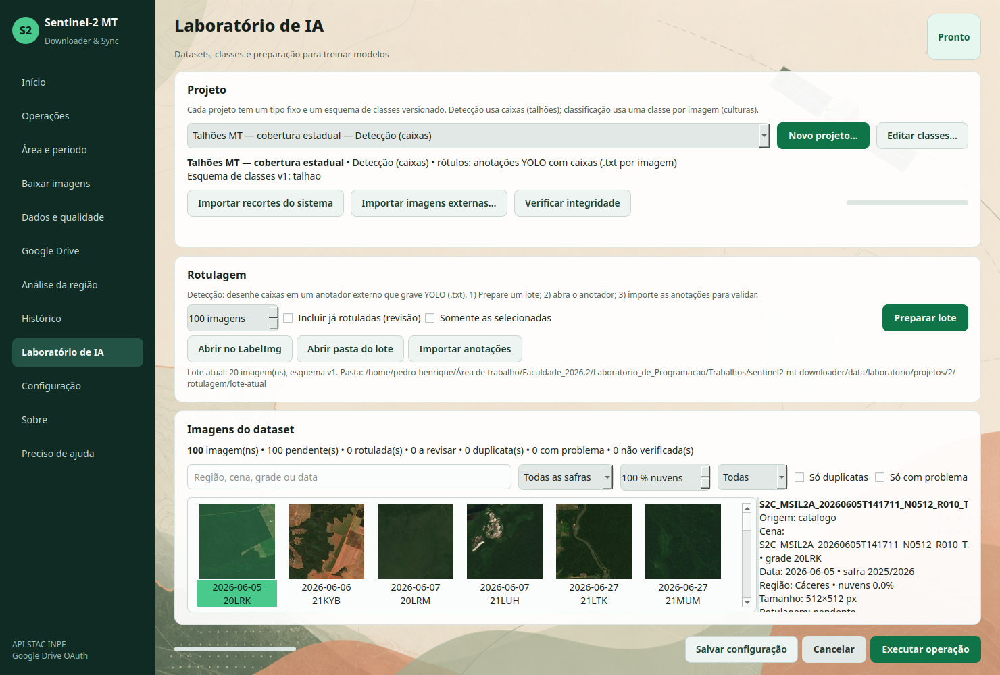
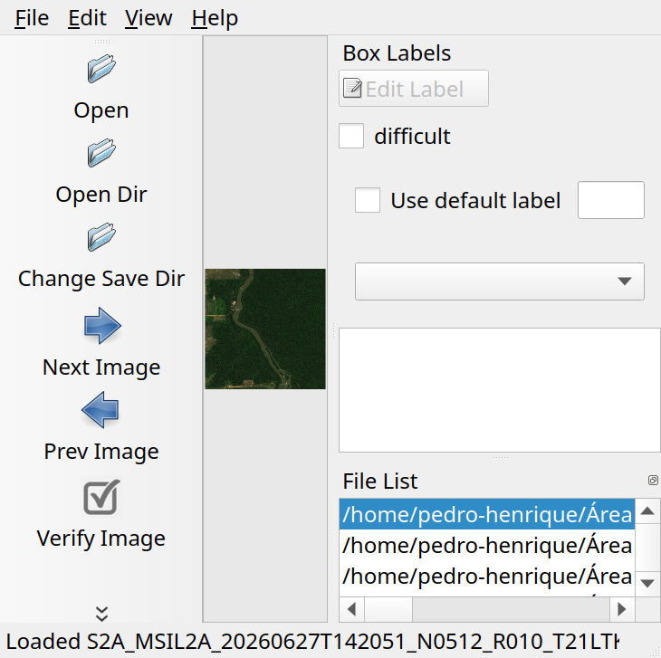

# Validação do dataset estadual de Mato Grosso e do lote para LabelImg

Data: 17/11/2026 · Worktree `../sentinel2-mt-cobertura`, branch `feat/cobertura-mato-grosso`,
commit `09e5ff8` (confirmado). Relatório não commitado. Nenhum merge, push, rebase ou exclusão.

**Resumo:** as 100 imagens estaduais existem, estão íntegras e aprovadas, distribuídas pelas 5
regiões intermediárias do IBGE. O Laboratório de IA funciona com o novo dataset e o lote inicial de
20 imagens (4 por região) abre corretamente no LabelImg real em formato YOLO, com a classe `talhao`.
Nenhuma anotação foi criada e nenhuma imagem foi marcada como rotulada.

## Git

| Item | Estado |
| --- | --- |
| Worktree | `feat/cobertura-mato-grosso` @ `09e5ff8`, árvore limpa |
| Checkout principal | `feat/laboratorio-rotulagem` @ `085ce38`, com alterações não commitadas preservadas: `rotulagem.py`, `test_rotulagem.py`, `reports/validacao-dataset.md`, `catalogo/patches.csv` e arquivos `.lock` |

## Quantidade e qualidade (revalidação a partir dos arquivos)

| Verificação | Resultado |
| --- | --- |
| Imagens existentes / íntegras / aprovadas | **100 / 100 / 100**, 0 problemas |
| Associação PNG ↔ GeoTIFF ↔ SCL ↔ metadata ↔ catálogo | 100/100 (mesma pasta; `patch_id` = pasta; PNG = UUID5 do `patch_id`; catálogo aponta para os mesmos arquivos; data e cena conferem) |
| Bandas e grade | B02/B03/B04, 10 m, uint16, nodata 0, 512×512; SCL 20 m alinhada |
| CRS | EPSG:32720 (12), 32721 (59), 32722 (29), UTM nativo, sem reprojeção |
| Nuvem/sombra na janela (SCL) | média 0,14 %, máximo 2,11 %; pixels válidos 100 % |
| Datas | jun/2026: 8, jul: 31, ago: 46, set: 15 (estação seca) |
| Diversidade espacial | 65 tiles MGRS; menor distância entre amostras 26,5 km; 0 PNG duplicados |
| PNG para rotulagem | brilho médio 28–164 de 255 (os mais escuros são floresta densa); saturação ≤ 4,3 % |

## Distribuição por região intermediária (IBGE)

| Região | Imagens no dataset | No lote inicial |
| --- | --- | --- |
| Sinop | 27 | 4 |
| Barra do Garças | 21 | 4 |
| Cuiabá | 19 | 4 |
| Cáceres | 17 | 4 |
| Rondonópolis | 16 | 4 |
| **Total** | **100** | **20** |

Mapa, folha de contato e lacunas: ver `reports/cobertura-mt-piloto-001.md`. Maiores lacunas: norte
da região de Sinop (até 176 km da amostra mais próxima) e oeste de Cáceres.

## Laboratório de IA

| Item | Resultado |
| --- | --- |
| Projeto | "Talhões MT — cobertura estadual" (id 2), detecção, esquema v1 `talhao` |
| Imagens | 100, todas íntegras (verificação refeita agora), 100 pendentes, 0 anotações |
| GUI | projeto listado; 100 itens com miniatura; região IBGE no detalhe; "Abrir no LabelImg" e "Importar anotações" habilitados |
| Lote | `data/laboratorio/projetos/2/rotulagem/lote-atual`: 20 imagens, 4 por região, `classes.txt` = `talhao`, `labels/` só com `classes.txt`. O lote preparado anteriormente já atendia ao pedido e foi mantido, em vez de ser recriado, o que apagaria e refaria a pasta |
| Projeto "Talhões MT" (id 1) | inalterado: 281 imagens pendentes, 0 anotações, lote próprio de 20 imagens preservado |



## LabelImg real

| Verificação | Resultado |
| --- | --- |
| Instalação | `~/.local/bin/labelImg` (LabelImg 1.8.6, Python 3.9.25 isolado via `uv`) |
| Imagens | 20/20 abertas, 512×512 |
| Classe | `talhao` (do `classes.txt` do lote) |
| Formato | YOLO ativo; botão mostra "YOLO" |
| Caixas existentes | 0 |
| Arquivos gravados | nenhum (`labels/` idêntico antes e depois) |



## Testes

- Relevantes (`test_cobertura`, `test_laboratorio`, `test_rotulagem`, `test_gui_qt`): 83, OK.
- Suíte completa no worktree: 287, OK, 0 pulados.

## Pendências

- Rotulagem manual das 20 imagens (próximo passo, humano).
- Este relatório e as capturas não estão commitados.
- Próximos lotes: preencher lacunas (norte de Sinop, oeste de Cáceres), incluir a estação chuvosa e
  estratificar por bioma e por atividade agrícola com fontes oficiais.
- Push e PR da branch `feat/cobertura-mato-grosso` dependem de autorização.

## Comando para abrir o lote estadual no LabelImg

```bash
cd "<pasta do sentinel2-mt-downloader>"
L="data/laboratorio/projetos/2/rotulagem/lote-atual"
labelImg "$L/images" "$L/classes.txt" "$L/labels"
```

Confirme **YOLO** no botão de formato, desenhe cada talhão com **W**, salve com **Ctrl+S** e avance
com **D**. Depois, no aplicativo, abra o Laboratório de IA, escolha "Talhões MT — cobertura
estadual" e clique em **Importar anotações**.
